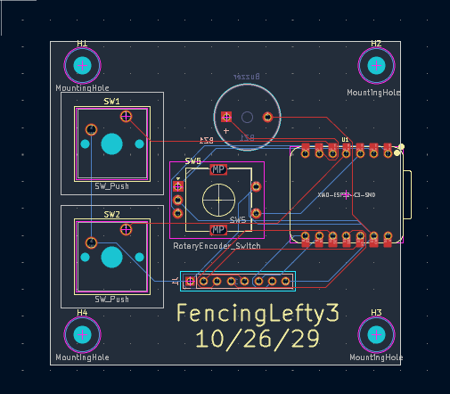
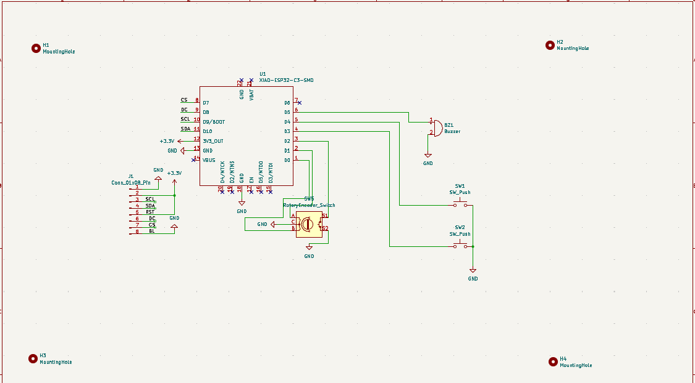
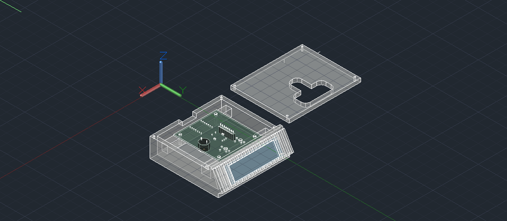

# SMRTClock Hardware Project

An opensource smart/display clock project run by a esp32. With a custom designed PCB in KiCAD, and a housing designed in AutoCAD.

## Images

## Bill of Materials
1         Rotary dial cap.

2         Keycaps of Choosing

1	        Buzzer

1	        Conn_01x08_Pin

2	        SW_Push

1	        RotaryEncoder_Switch

1	        XIAO-ESP32-C3-SMD

1         Case part(s) 3D Print

1x       2.54mm 8 Pin Male Header (For connecting your screen)
      
8x       20cm Female-Female Jumper Wires (For connecting your screen off of the pcb)

8x      M3x5x4 Heatset Inserts

4x     M3x8mm Screws

4x    M3x16mm Screws
